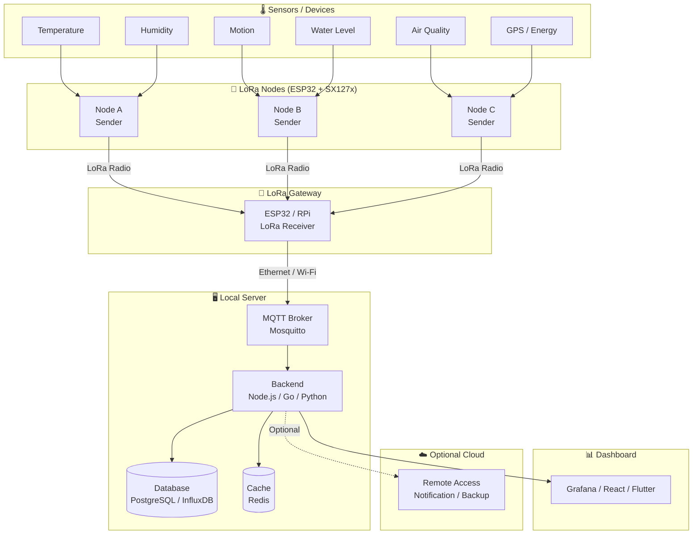

# LoRa Local Network

> **Wireless and internet-free**, using radio waves to transmit data over distances of **1–5 km**.

A lightweight communication architecture for connecting devices, sensors, gateways, and local systems using **LoRa (Long Range)** radio technology — without requiring cables, Wi-Fi, or an internet connection.

Designed for a wide range of applications including **IoT, smart buildings, agriculture, livestock, industrial monitoring, environmental monitoring, telemetry, and automation**.

---

## Badges


---

## Contents

- [Architecture](#architecture)
- [Quick Start — ESP32 + LoRa](#quick-start--esp32--lora)
- [Code Examples](#code-examples)
- [Protocol Packet](#protocol-packet)
- [Library Reference](#library-reference)
- [Documentation](#documentation)
- [Repository Layout](#repository-layout)
- [Roadmap](#roadmap)

## Documentation

| Document | What it answers |
| -------- | --------------- |
| [docs/GETTING_STARTED.md](docs/GETTING_STARTED.md) | zero → first JSON packet, step by step |
| [docs/PROTOCOL.md](docs/PROTOCOL.md) | 9-byte frame spec, validation rules, JSON bridge format, how to extend it |
| [docs/API_CHOICE.md](docs/API_CHOICE.md) | `LoRa` vs `RadioLib` vs LoRaMac-node — which one and when, plus porting table |
| [docs/HARDWARE.md](docs/HARDWARE.md) | wiring matrix (ESP32 / Uno / ESP8266), power, antenna, frequencies |
| [docs/TROUBLESHOOTING.md](docs/TROUBLESHOOTING.md) | compile errors, silent gateways, range problems, red CI |

## Repository Layout

```text
src/                     compiled by every build
  LocalPacket.h            9-byte LocalNetwork codec (this project, unit-tested)
  LoRa.h / LoRa.cpp        classic arduino-LoRa API
  RadioLib.h + modules/    RadioLib: every module and protocol
examples/                149 sketches
  LocalNetwork_Node/       original node example
  LocalNetwork_Gateway/    original gateway example (JSON serial bridge)
  LoRa*.ino                 classic arduino-LoRa sketches (example root)
  SX127x/ SX126x/ ...       RadioLib sketches, one folder per topic
extras/
  mac/                      LoRaMac-node MAC - reference only, never compiled
  tests/                    host unit tests (g++), run by CI
  licenses/                 upstream license texts
docs/                      the five guides linked above
library.properties         Arduino library metadata
keywords.txt               IDE syntax highlighting for both APIs
```

Original to this repository: `src/LocalPacket.h`, the two
`examples/LocalNetwork_*` sketches, `extras/tests/` and `docs/`. The radio
stacks themselves are bundled upstream libraries — full attribution in
[THIRD_PARTY_LICENSES.md](THIRD_PARTY_LICENSES.md).

---

## Architecture

```text
┌──────────────────────┐
│   Device / Sensor    │
│                      │
│ Temperature ─┐      │
│ Humidity ────┤      │
│ Motion ──────┤      │
│ Level ───────┤      │
│ Status ──────┘      │
└──────────┬───────────┘
           │
         LoRa
           │
           ▼
┌──────────────────────┐
│     LoRa Gateway     │
│                      │
│  Local Server / PC   │
└──────────┬───────────┘
           │
        Ethernet
           │
           ▼
      ┌───────────┐
      │ Dashboard │
      └───────────┘
```

Devices transmit data over **LoRa radio** to a gateway. The gateway then forwards the data to a **local server or PC** through a local network such as Ethernet.

The primary communication path **does not require the internet**.

---

## How It Works

```text
Device
   │
   │ Radio
   ▼
 LoRa
   │
   ▼
Gateway
   │
   │ Local Network
   ▼
Server
   │
   ▼
Application
```

### 1. Device / Sensor

A device can be anything capable of collecting or generating data:

* Temperature sensors
* Humidity sensors
* Motion sensors
* Light sensors
* Water level sensors
* Air quality sensors
* Energy meters
* GPS modules
* Industrial sensors
* Actuators
* Custom embedded devices

The device collects data and transmits it wirelessly using LoRa.

### 2. LoRa

LoRa provides the long-range wireless communication layer.

Key characteristics:

* No physical cable
* No Wi-Fi required
* No internet required
* Low power consumption
* Long communication range
* Suitable for small telemetry payloads

A **1–5 km range** can be achievable depending on antenna configuration, frequency, transmit power, spreading factor, terrain, obstacles, and environmental conditions.

### 3. LoRa Gateway

The gateway receives LoRa packets from one or multiple devices.

It can forward the data to:

* Local servers
* PCs
* Raspberry Pi
* Industrial computers
* Edge servers
* Local databases
* Automation systems

The gateway-to-server connection can use:

```text
Ethernet
Wi-Fi
Serial
USB
or another local networking method
```

### 4. Local Server

The local server processes, stores, and distributes device data.

For example:

```text
LoRa Gateway
      │
      ▼
   MQTT
      │
      ▼
   Backend
      │
      ├── PostgreSQL
      ├── Redis
      └── Time-Series Database
```

Because the server can operate entirely on the local network, the system can continue operating even when the internet connection is unavailable.

### 5. Dashboard

The collected data can be visualized through a local dashboard.

```text
┌────────────────────────────────────┐
│             Dashboard              │
├────────────────────────────────────┤
│ Temperature       28.4 °C          │
│ Humidity          72 %             │
│ Device Status     ONLINE           │
│ Battery           84 %             │
│ Last Update       10:32:41         │
└────────────────────────────────────┘
```

---

## Internet Is Optional

The main communication path does not depend on the internet.

```text
                 WITHOUT INTERNET

┌────────┐
│ Device │
└───┬────┘
    │
   LoRa
    │
    ▼
┌─────────┐
│ Gateway │
└────┬────┘
     │
  Ethernet
     │
     ▼
┌─────────┐
│ Server  │
└────┬────┘
     │
     ▼
┌─────────┐
│Dashboard│
└─────────┘
```

Internet connectivity can be added when remote access or cloud services are required:

* Remote monitoring
* Cloud synchronization
* Remote access
* Notifications
* External APIs
* Data backup
* Multi-site monitoring

This makes the architecture **local-first**, while still allowing cloud connectivity when needed.

---

## Use Cases

The architecture is designed to be general-purpose.

### Smart Building

```text
Temperature
Humidity
Energy Meter
Motion
Air Quality
      │
      ▼
    LoRa
      │
      ▼
   Gateway
      │
      ▼
Building Dashboard
```

### Agriculture

```text
Soil Moisture
Temperature
Humidity
Water Level
      │
      ▼
    LoRa
      │
      ▼
   Gateway
```

### Livestock

```text
Temperature
Humidity
Water Level
Feed Level
Animal Monitoring
      │
      ▼
    LoRa
```

### Industrial Monitoring

```text
Machine Status
Vibration
Temperature
Pressure
Energy
      │
      ▼
    LoRa
      │
      ▼
   Gateway
      │
      ▼
Industrial Server
```

### Environmental Monitoring

```text
Air Quality
Temperature
Humidity
Water Quality
Weather
      │
      ▼
    LoRa
      │
      ▼
   Gateway
```

---

## Point-to-Point Communication

For simple applications, LoRa can be used for direct device-to-device communication.

```text
┌──────────┐
│ Device A │
└────┬─────┘
     │
    LoRa
     │
     ▼
┌──────────┐
│ Device B │
└──────────┘
```

This approach is useful when a dedicated gateway or server is unnecessary.

---

## Multi-Device Communication

For larger deployments, multiple devices can communicate with a gateway.

```text
              ┌────────────┐
              │  Device A  │
              └─────┬──────┘
                    │
                   LoRa
                    │
┌────────────┐      │
│  Device B  │──────┤
└────────────┘      │
                    ▼
              ┌───────────┐
              │  Gateway  │
              └─────┬─────┘
                    │
                 Ethernet
                    │
                    ▼
              ┌───────────┐
              │  Server   │
              └───────────┘
```

The actual number of devices depends on the radio configuration, protocol, traffic pattern, hardware, and network architecture.

---

## Technology Stack

### Devices

* ESP32
* STM32
* Arduino
* Raspberry Pi
* Custom MCUs

### LoRa Radios

* SX1276
* SX1278
* SX1262
* SX1268

### Communication

* LoRa
* LoRaWAN
* MQTT
* UART
* SPI

### Backend

* Node.js
* Go
* Python
* PostgreSQL
* Redis
* MQTT Broker

### Dashboard

* React
* Next.js
* Flutter
* Vue
* Svelte

---

## LoRa vs Internet

| Feature                  |     LoRa |  Internet |
| ------------------------ | -------: | --------: |
| Wireless                 |        ✅ |         ✅ |
| Physical cable required  |        ❌ |  Optional |
| Internet required        |        ❌ | Usually ✅ |
| Long-range communication |        ✅ |   Depends |
| Low power                |        ✅ |   Depends |
| Small telemetry          |        ✅ |         ✅ |
| Local communication      |        ✅ |  Possible |
| Cloud access             | Optional |         ✅ |

LoRa is **not intended to replace the internet**.

It is optimized for a different problem: **sending small amounts of data between devices over long distances with low power consumption**.

---

## Range

The **1–5 km** range mentioned by this project is a practical reference, not a guaranteed specification.

Actual range depends on:

* Antenna
* Antenna height
* Frequency
* Transmit power
* Spreading factor
* Bandwidth
* Terrain
* Buildings
* Vegetation
* Interference
* Local radio regulations

Under suitable conditions and configurations, LoRa communication can reach significantly farther.

---

## Design Philosophy

This project follows three simple principles:

```text
          CONNECT
             │
             ▼
         ┌───────┐
         │  LoRa │
         └───────┘
             │
             ▼
           MOVE
           DATA
             │
             ▼
           STAY
          LOCAL
```

### Local-first

The system should remain functional without depending on cloud infrastructure or an internet connection.

### Long-range

Devices can be distributed across large areas while maintaining low-power wireless communication.

### Simple telemetry

LoRa is designed for sending **small, meaningful data packets**, rather than large files or high-bandwidth media.

---

## Goal

The goal is to provide a simple foundation for building **long-range, low-power, local-first communication networks** for devices and sensors.

> **Connect devices. Move data. Stay local.**

**No cables. No internet. Just radio.**

---

## Feature Matrix

| Feature                        | LoRa P2P | LoRaWAN | Wi-Fi | Zigbee | Cellular |
| ------------------------------ | :------: | :-----: | :---: | :----: | :------: |
| Range (typical)                | 1–5 km   | 2–15 km | <100m | <100m  | Global   |
| Internet required              | ❌        | Optional | Usually ✅ | ❌    | ✅        |
| Low power                      | ✅        | ✅       | ❌    | ✅     | ❌        |
| Infrastructure required        | ❌        | Gateway  | AP    | Coord. | SIM/Tower|
| Bidirectional                  | ✅        | ✅       | ✅    | ✅     | ✅        |
| Max payload (bytes)            | 255       | 51–242  | High  | 127    | High     |
| Data rate                      | Low       | Low     | High  | Medium | High     |
| Penetration (buildings/walls)  | ✅        | ✅       | ⚠️    | ⚠️    | ✅        |
| License-free band              | ✅        | ✅       | ✅    | ✅     | ❌        |
| Multi-node support             | ✅        | ✅       | ✅    | ✅     | ✅        |
| Local-first                    | ✅        | ✅       | ✅    | ✅     | ❌        |
| Typical cost per node          | Low       | Low     | Low   | Medium | High     |

---

## Architecture Diagram



---

## Quick Start — ESP32 + LoRa

### Prerequisites

| Item             | Detail                                |
| ---------------- | ------------------------------------- |
| Microcontroller  | ESP32 (any variant)                   |
| LoRa Module      | SX1276 / SX1278 / SX1262 (breakout)  |
| IDE              | Arduino IDE 2.x or PlatformIO         |
| Library          | This repo (bundles `LoRa` + RadioLib) |
| Frequency        | 433 MHz / 868 MHz / 915 MHz (region-specific) |

### Wiring (ESP32 ↔ SX1276)

```
ESP32 Pin   →   SX1276 Pin
─────────────────────────────
3.3V        →   VCC
GND         →   GND
GPIO 18     →   SCK
GPIO 19     →   MISO
GPIO 23     →   MOSI
GPIO 5      →   NSS  (CS)
GPIO 14     →   RST
GPIO 26     →   DIO0 (IRQ)
```

### Install Library — this repository (recommended)

This repo is a complete Arduino library: it bundles **`LoRa` (Sandeep Mistry)**
and **RadioLib (Jan Gromeš)**, so both work from one install:

```
Sketch → Include Library → Add .ZIP Library…
        (or copy this folder into Arduino/libraries/LoRa-wan)
```

PlatformIO (`platformio.ini`):

```ini
[env:esp32dev]
platform = espressif32
board = esp32dev
framework = arduino
lib_deps =
    symlink://../path/to/LoRa-wan
```

Both styles then work:

```cpp
#include <LoRa.h>        // classic API (sender/receiver sketches)
#include <RadioLib.h>    // advanced modules + LoRaWAN
```

### Alternative — install upstream libraries individually

```
Sketch → Include Library → Manage Libraries
Search: "LoRa" by Sandeep Mistry → Install
Search: "RadioLib" by Jan Gromes → Install
```

Or via PlatformIO (`platformio.ini`):

```ini
[env:esp32dev]
platform = espressif32
board = esp32dev
framework = arduino
lib_deps =
    sandeepmistry/LoRa @ ^0.8.0
```

---

## Code Examples

### Sender (Node / Device)

```cpp
// lora_sender.ino
// ESP32 LoRa Sender — transmits sensor data periodically

#include <SPI.h>
#include <LoRa.h>

// Pin definitions (adjust to your wiring)
#define LORA_SCK   18
#define LORA_MISO  19
#define LORA_MOSI  23
#define LORA_CS     5
#define LORA_RST   14
#define LORA_IRQ   26

// LoRa configuration
#define LORA_FREQ     433E6   // 433 MHz (use 868E6 or 915E6 for your region)
#define LORA_SF        10     // Spreading Factor (7–12). Higher = longer range, slower
#define LORA_BW    125E3      // Bandwidth in Hz
#define LORA_TX_PWR    17     // TX power in dBm (2–20)

// Packet config
#define NODE_ID     0x01      // Unique ID for this sender node
#define DEST_ID     0xFF      // 0xFF = broadcast; set to gateway ID for unicast

uint16_t packetCounter = 0;

void setup() {
    Serial.begin(115200);
    while (!Serial);

    // Init SPI pins
    SPI.begin(LORA_SCK, LORA_MISO, LORA_MOSI, LORA_CS);
    LoRa.setPins(LORA_CS, LORA_RST, LORA_IRQ);

    if (!LoRa.begin(LORA_FREQ)) {
        Serial.println("[ERROR] LoRa init failed. Check wiring.");
        while (true);
    }

    LoRa.setSpreadingFactor(LORA_SF);
    LoRa.setSignalBandwidth(LORA_BW);
    LoRa.setTxPower(LORA_TX_PWR);
    LoRa.enableCrc();  // Enable CRC for data integrity

    Serial.println("[OK] LoRa Sender ready.");
}

void loop() {
    // --- Read sensor data (replace with real sensor reads) ---
    float temperature = 28.4 + random(-10, 10) * 0.1;
    float humidity    = 72.0 + random(-5, 5) * 0.1;
    int   batteryPct  = 84;

    // --- Build packet payload ---
    // Format: NODE_ID | DEST_ID | COUNTER | TEMP | HUM | BAT
    LoRa.beginPacket();
    LoRa.write(NODE_ID);                // 1 byte: sender ID
    LoRa.write(DEST_ID);                // 1 byte: destination
    LoRa.write(packetCounter >> 8);     // 1 byte: counter high
    LoRa.write(packetCounter & 0xFF);   // 1 byte: counter low
    LoRa.write((uint8_t)(temperature * 10 >> 8));   // temp high byte
    LoRa.write((uint8_t)(temperature * 10 & 0xFF)); // temp low byte
    LoRa.write((uint8_t)(humidity * 10 >> 8));      // hum high byte
    LoRa.write((uint8_t)(humidity * 10 & 0xFF));    // hum low byte
    LoRa.write(batteryPct);             // 1 byte: battery %
    LoRa.endPacket();

    Serial.printf("[TX] Packet #%d | Temp=%.1f°C | Hum=%.1f%% | Bat=%d%%\n",
                  packetCounter, temperature, humidity, batteryPct);

    packetCounter++;
    delay(5000);  // Send every 5 seconds
}
```

### Receiver (Gateway Node)

```cpp
// lora_receiver.ino
// ESP32 LoRa Receiver — listens for packets and parses payload

#include <SPI.h>
#include <LoRa.h>

// Pin definitions (match your wiring)
#define LORA_SCK   18
#define LORA_MISO  19
#define LORA_MOSI  23
#define LORA_CS     5
#define LORA_RST   14
#define LORA_IRQ   26

// LoRa configuration (must match sender)
#define LORA_FREQ  433E6
#define LORA_SF      10
#define LORA_BW    125E3

// Parsed data struct
struct SensorPacket {
    uint8_t  nodeId;
    uint8_t  destId;
    uint16_t counter;
    float    temperature;
    float    humidity;
    uint8_t  battery;
    int      rssi;
    float    snr;
};

void parsePacket(int packetSize, SensorPacket &pkt);
void printPacket(const SensorPacket &pkt);

void setup() {
    Serial.begin(115200);
    while (!Serial);

    SPI.begin(LORA_SCK, LORA_MISO, LORA_MOSI, LORA_CS);
    LoRa.setPins(LORA_CS, LORA_RST, LORA_IRQ);

    if (!LoRa.begin(LORA_FREQ)) {
        Serial.println("[ERROR] LoRa init failed.");
        while (true);
    }

    LoRa.setSpreadingFactor(LORA_SF);
    LoRa.setSignalBandwidth(LORA_BW);
    LoRa.enableCrc();

    Serial.println("[OK] LoRa Receiver listening...");
}

void loop() {
    int packetSize = LoRa.parsePacket();

    if (packetSize > 0) {
        SensorPacket pkt;
        parsePacket(packetSize, pkt);
        pkt.rssi = LoRa.packetRssi();
        pkt.snr  = LoRa.packetSnr();
        printPacket(pkt);
    }
}

void parsePacket(int packetSize, SensorPacket &pkt) {
    if (packetSize < 9) {
        Serial.printf("[WARN] Short packet: %d bytes — skipping\n", packetSize);
        return;
    }

    pkt.nodeId      = LoRa.read();
    pkt.destId      = LoRa.read();
    uint8_t cntHi   = LoRa.read();
    uint8_t cntLo   = LoRa.read();
    pkt.counter     = (cntHi << 8) | cntLo;
    uint8_t tHi     = LoRa.read();
    uint8_t tLo     = LoRa.read();
    pkt.temperature = ((tHi << 8) | tLo) / 10.0f;
    uint8_t hHi     = LoRa.read();
    uint8_t hLo     = LoRa.read();
    pkt.humidity    = ((hHi << 8) | hLo) / 10.0f;
    pkt.battery     = LoRa.read();
}

void printPacket(const SensorPacket &pkt) {
    Serial.println("─────────────────────────────────────");
    Serial.printf("  Node ID     : 0x%02X\n",   pkt.nodeId);
    Serial.printf("  Dest ID     : 0x%02X\n",   pkt.destId);
    Serial.printf("  Packet #    : %d\n",        pkt.counter);
    Serial.printf("  Temperature : %.1f °C\n",   pkt.temperature);
    Serial.printf("  Humidity    : %.1f %%\n",   pkt.humidity);
    Serial.printf("  Battery     : %d %%\n",     pkt.battery);
    Serial.printf("  RSSI        : %d dBm\n",    pkt.rssi);
    Serial.printf("  SNR         : %.2f dB\n",   pkt.snr);
    Serial.println("─────────────────────────────────────");
}
```

---

## Protocol Packet

### Packet Structure

```
 Byte Offset │  Size  │  Field          │  Description
─────────────┼────────┼─────────────────┼───────────────────────────────────
      0       │ 1 byte │ NODE_ID         │ Unique sender node identifier
      1       │ 1 byte │ DEST_ID         │ Destination (0xFF = broadcast)
      2–3     │ 2 byte │ COUNTER         │ Packet sequence number (big-endian)
      4–5     │ 2 byte │ TEMPERATURE     │ Temp × 10 as int16 (e.g. 284 = 28.4°C)
      6–7     │ 2 byte │ HUMIDITY        │ Hum × 10 as int16 (e.g. 720 = 72.0%)
      8       │ 1 byte │ BATTERY         │ Battery percentage (0–100)
─────────────┴────────┴─────────────────┴───────────────────────────────────
 Total: 9 bytes payload  +  LoRa PHY header  +  CRC (2 bytes, auto-appended)
```

### Bit-level View

```
┌────────┬────────┬─────────────────┬─────────────────┬─────────────────┬────────┐
│NODE_ID │DEST_ID │    COUNTER      │   TEMPERATURE   │    HUMIDITY     │  BAT   │
│ 8 bits │ 8 bits │ 8 bits │ 8 bits │ 8 bits │ 8 bits │ 8 bits │ 8 bits │ 8 bits │
└────────┴────────┴────────┴────────┴────────┴────────┴────────┴────────┴────────┘
  Byte 0   Byte 1   Byte 2   Byte 3   Byte 4   Byte 5   Byte 6   Byte 7   Byte 8
```

### Encoding Rules

| Field       | Type     | Scale  | Range             | Example            |
| ----------- | -------- | ------ | ----------------- | ------------------ |
| NODE_ID     | uint8    | —      | 0x01–0xFE         | `0x01`             |
| DEST_ID     | uint8    | —      | 0x01–0xFF (0xFF=BC)| `0xFF`            |
| COUNTER     | uint16   | —      | 0–65535           | `0x0001` = pkt #1  |
| TEMPERATURE | int16    | ×10    | −400 to +850      | `0x011C` = 28.4°C  |
| HUMIDITY    | uint16   | ×10    | 0 to 1000         | `0x02D0` = 72.0%   |
| BATTERY     | uint8    | %      | 0–100             | `0x54` = 84%       |

### Signal Quality Reference

| RSSI (dBm)  | SNR (dB) | Link Quality         |
| ----------- | -------- | -------------------- |
| > −90       | > 10     | 🟢 Excellent          |
| −90 to −100 | 5 to 10  | 🟡 Good               |
| −100 to −110| 0 to 5   | 🟠 Fair               |
| < −110      | < 0      | 🔴 Weak / Unreliable  |

---

## Library Reference

Proyek ini dapat diimplementasikan menggunakan salah satu dari tiga library utama. Masing-masing memiliki target use-case yang berbeda.

| Library            | Maintainer       | Target Use-Case                              | License |
| ------------------ | ---------------- | -------------------------------------------- | ------- |
| **arduino-LoRa**   | Sandeep Mistry   | Prototyping cepat, Arduino/ESP32 sederhana   | MIT     |
| **RadioLib**       | Jan Gromeš       | Multi-modul, multi-protokol, production-grade| MIT     |
| **LoRaMac-node**   | Semtech / STACKFORCE | LoRaWAN Class A/B/C stack penuh, C embedded | Revised BSD |

---

### 1. arduino-LoRa (`LoRa` by Sandeep Mistry)

Library paling sederhana untuk Arduino/ESP32. Mengekspos SX127x secara langsung via SPI.

**Kompatibilitas chip:** SX1276, SX1277, SX1278, SX1279 (register 0x42 version check)

**Default SPI pins (non-MKR boards):**

```cpp
// dari src/LoRa.h
#define LORA_DEFAULT_SPI           SPI
#define LORA_DEFAULT_SPI_FREQUENCY 8E6     // 8 MHz
#define LORA_DEFAULT_SS_PIN        10
#define LORA_DEFAULT_RESET_PIN     9
#define LORA_DEFAULT_DIO0_PIN      2
```

**API Lengkap (dari `API.md` & `src/LoRa.h`):**

```cpp
// Setup
LoRa.setPins(ss, reset, dio0);      // override default pins — HARUS sebelum begin()
LoRa.setSPI(spi);                   // override SPI interface
LoRa.setSPIFrequency(frequency);    // default 8E6; turunkan jika level shifter lambat
LoRa.begin(frequency);              // 433E6 / 868E6 / 915E6 — returns 1=OK, 0=fail
LoRa.end();

// Kirim (TX)
LoRa.beginPacket();                 // returns 1=ready, 0=busy
LoRa.beginPacket(true);            // implicit header mode
LoRa.write(byte);                   // tulis 1 byte; juga support write(buffer, len)
LoRa.print("string");               // via Arduino Print API
LoRa.endPacket();                   // blocking; returns 1=OK
LoRa.endPacket(true);              // async (non-blocking)
LoRa.onTxDone(callback);           // ISR via DIO0

// Terima (RX)
LoRa.parsePacket();                 // polling; returns packetSize atau 0
LoRa.parsePacket(size);            // implicit header, expect `size` bytes
LoRa.receive();                     // continuous RX mode
LoRa.onReceive(callback);          // ISR via DIO0
LoRa.available();                   // bytes tersedia
LoRa.read();                        // baca 1 byte
LoRa.peek();                        // lihat tanpa consume

// Signal quality
LoRa.packetRssi();                  // RSSI paket terakhir (dBm)
LoRa.packetSnr();                   // SNR estimasi (dB)
LoRa.packetFrequencyError();        // frequency error (Hz)
LoRa.rssi();                        // RSSI real-time (bisa dibaca kapan saja)

// Channel Activity Detection
LoRa.channelActivityDetection();
LoRa.onCadDone(callback);          // callback(bool signalDetected)

// Power management
LoRa.idle();                        // standby
LoRa.sleep();                       // sleep mode

// Radio parameters
LoRa.setTxPower(level);            // 2–20 dBm (PA_BOOST); 0–14 dBm (RFO)
LoRa.setTxPower(level, PA_OUTPUT_RFO_PIN);
LoRa.setFrequency(frequency);
LoRa.setSpreadingFactor(sf);       // 6–12; SF6 wajib implicit header
LoRa.setSignalBandwidth(bw);       // 7.8E3–500E3 Hz
LoRa.setCodingRate4(denom);        // 5–8 → 4/5 sampai 4/8
LoRa.setPreambleLength(length);    // 6–65535 simbol, default 8
LoRa.setSyncWord(sw);              // default 0x12 (private), 0x34 = LoRaWAN public
LoRa.enableCrc();  / LoRa.disableCrc();
LoRa.enableInvertIQ();  / LoRa.disableInvertIQ();  // untuk Gateway/Node separation
LoRa.enableLowDataRateOptimize();  // wajib jika SF11/SF12 + BW125
LoRa.setOCP(mA);                   // Over Current Protection
LoRa.setGain(gain);                // 0=AGC, 1–6=manual LNA gain
LoRa.random();                     // random byte dari wideband RSSI
LoRa.dumpRegisters(Serial);        // debug semua register
```

**Pola InvertIQ — Gateway vs Node (dari `examples/LoRaSimpleGateway`):**

```cpp
// GATEWAY: TX dengan InvertIQ enabled, RX dengan InvertIQ disabled
// NODE:    TX dengan InvertIQ disabled, RX dengan InvertIQ enabled
// → Gateway tidak akan terima dari Gateway lain; Node tidak terima dari Node lain

// Gateway RX mode
void LoRa_rxMode() {
  LoRa.disableInvertIQ();   // terima dari Node
  LoRa.receive();
}
// Gateway TX mode
void LoRa_txMode() {
  LoRa.idle();
  LoRa.enableInvertIQ();    // kirim ke Node
}

// Node RX mode
void LoRa_rxMode() {
  LoRa.enableInvertIQ();    // terima dari Gateway
  LoRa.receive();
}
// Node TX mode
void LoRa_txMode() {
  LoRa.idle();
  LoRa.disableInvertIQ();   // kirim ke Gateway
}
```

---

### 2. RadioLib

Library universal multi-modul dengan arsitektur OOP. Mendukung puluhan chip radio dan protokol.

**Chip yang didukung (dari `src/modules/`):**

| Keluarga       | Chip                                              | Frekuensi        |
| -------------- | ------------------------------------------------- | ---------------- |
| **SX127x**     | SX1272, SX1273, SX1276, SX1277, SX1278, SX1279   | 137–1020 MHz     |
| **SX126x**     | SX1261, SX1262, SX1268                            | 150–960 MHz      |
| **SX128x**     | SX1280, SX1281, SX1282                            | 2.4 GHz          |
| **LR11x0**     | LR1110, LR1120, LR1121                            | Multi-band       |
| **RFM9x**      | RFM95, RFM96, RFM97, RFM98                        | SX127x-based     |
| **LLCC68**     | LLCC68                                            | LoRa sub-GHz     |
| **STM32WLx**   | STM32WL (integrated MCU+radio)                    | Sub-GHz          |

**Protokol yang didukung (dari `src/protocols/`):** LoRa, LoRaWAN (Class A & C), FSK, AX.25, APRS, RTTY, Morse, SSTV, Hellschreiber, POCSAG, ADS-B, AFSK

**Inisialisasi SX1278 (blocking TX pattern):**

```cpp
#include <RadioLib.h>

// Koneksi: NSS=10, DIO0=2, RST=9, DIO1=3
SX1278 radio = new Module(10, 2, 9, 3);

void setup() {
  Serial.begin(9600);

  // Init dengan ConfigLoRa_t struct (cara baru)
  ConfigLoRa_t config;
  config.frequency = 434;   // MHz
  int state = radio.begin(config);

  // Atau cara lama (deprecated tapi masih valid):
  // int state = radio.begin(434.0, 125.0, 9, 7);
  // radio.begin(freq_MHz, bw_kHz, sf, cr_denom)

  if (state != RADIOLIB_ERR_NONE) {
    Serial.print("init failed, code "); Serial.println(state);
    while (true);
  }
}
```

**SX1262 — parameter dari `src/modules/SX126x/SX1262.h`:**

```cpp
// SX1262: freq 150–960 MHz, TX power -9 to +22 dBm
SX1262 radio = new Module(10, 2, 9, 3);

// Signature lengkap:
// begin(freq=434.0, bw=125.0, sf=9, cr=7, syncWord=0x12,
//       power=10, preambleLength=8, tcxoVoltage=1.6, useRegulatorLDO=false)
radio.begin(433.0, 125.0, 10, 5, RADIOLIB_SX126X_SYNC_WORD_PRIVATE, 17);
```

**Interrupt-driven RX (pattern dari `examples/SX127x/SX127x_Receive_Interrupt`):**

```cpp
#include <RadioLib.h>
SX1278 radio = new Module(10, 2, 9, 3);

volatile bool receivedFlag = false;

// ISR — harus void, tanpa argument
#if defined(ESP8266) || defined(ESP32)
  ICACHE_RAM_ATTR
#endif
void setFlag(void) {
  receivedFlag = true;
}

void setup() {
  ConfigLoRa_t config;
  config.frequency = 434;
  radio.begin(config);

  radio.setPacketReceivedAction(setFlag);  // daftarkan ISR
  radio.startReceive();                    // masuk continuous RX
}

void loop() {
  if (receivedFlag) {
    receivedFlag = false;

    String str;
    int state = radio.readData(str);

    if (state == RADIOLIB_ERR_NONE) {
      Serial.println(str);
      Serial.print("RSSI: "); Serial.println(radio.getRSSI());
      Serial.print("SNR:  "); Serial.println(radio.getSNR());
      Serial.print("FreqErr: "); Serial.println(radio.getFrequencyError());
    } else if (state == RADIOLIB_ERR_CRC_MISMATCH) {
      Serial.println("CRC error!");
    }
  }
}
```

**SX127x Register Map (dari `src/modules/SX127x/SX127x.h`):**

```
Register Name                    Address   Description
─────────────────────────────────────────────────────────────
REG_FIFO                         0x00      FIFO read/write access
REG_OP_MODE                      0x01      Mode: SLEEP/STDBY/TX/RXCONT/CAD
REG_FRF_MSB / MID / LSB         0x06–08   Carrier frequency (Frf = Fosc × Frf / 2^19)
REG_PA_CONFIG                    0x09      PA output pin + output power
REG_LNA                          0x0C      LNA gain (G1=max, G6=min)
REG_MODEM_CONFIG_1               0x1D      BW, CR, implicit header
REG_MODEM_CONFIG_2               0x1E      SF, TX mode, CRC, RX timeout MSB
REG_PREAMBLE_MSB/LSB            0x20–21   Preamble length (default 8+4.25 symbols)
REG_PAYLOAD_LENGTH               0x22      Payload length (implicit mode)
REG_SYNC_WORD                    0x39      Sync word (0x12=private, 0x34=LoRaWAN)
REG_INVERT_IQ                    0x33      IQ inversion (reg 0x33 per SX1276 DS)
REG_DIO_MAPPING_1                0x40      DIO0–DIO3 function mapping
REG_VERSION                      0x42      Chip version (SX1276=0x12, SX1278=0x12)
```

**Spreading Factor → chips/bit (dari `SX127x.h`):**

```
SF6  = 64  chips/bit   → SF dg SF6 wajib implicit header
SF7  = 128 chips/bit
SF8  = 256 chips/bit
SF9  = 512 chips/bit
SF10 = 1024 chips/bit
SF11 = 2048 chips/bit  → Low Data Rate Optimize wajib jika BW=125kHz
SF12 = 4096 chips/bit  → Low Data Rate Optimize wajib jika BW=125kHz
```

**Error codes penting (`RADIOLIB_ERR_*`):**

| Code | Konstanta                    | Penyebab                                |
| ---- | ---------------------------- | --------------------------------------- |
| 0    | `RADIOLIB_ERR_NONE`          | Sukses                                  |
| -2   | `RADIOLIB_ERR_PACKET_TOO_LONG` | Payload > 255 bytes                   |
| -3   | `RADIOLIB_ERR_TX_TIMEOUT`    | TX timeout                              |
| -4   | `RADIOLIB_ERR_RX_TIMEOUT`    | RX timeout                              |
| -5   | `RADIOLIB_ERR_CRC_MISMATCH`  | CRC gagal                               |
| -706 | (TCXO error)                 | tcxoVoltage salah — set 0 jika pakai XTAL |

---

### 3. LoRaMac-node (Semtech / STACKFORCE)

Stack LoRaWAN resmi untuk embedded C. Mendukung LoRaWAN 1.0.x dan 1.1.x, Class A, B, dan C.

> **Lokasi di repo ini:** `extras/mac/` (salinan lengkap 37+ file) — **tidak
> di-compile** oleh build Arduino, hanya referensi. Alasan & cara porting ada di
> [`extras/mac/README.md`](extras/mac/README.md). Untuk LoRaWAN yang benar-benar
> jalan di Arduino/ESP32, gunakan [RadioLib LoRaWAN](#2-radiolib) di `examples/LoRaWAN/`.

**Frame Structure LoRaWAN (dari `extras/mac/LoRaMacHeaderTypes.h`):**

```
PHYPayload = MHDR(1) + MACPayload + MIC(4)

MACPayload = FHDR + FPort(1, opsional) + FRMPayload
FHDR       = DevAddr(4) + FCtrl(1) + FCnt(2) + FOpts(0–15)

Ukuran field (bytes):
  MHDR     = 1    (MType: 3 bit + RFU: 3 bit + Major: 2 bit)
  DevAddr  = 4
  FCtrl    = 1    (ADR, ADRACKReq, ACK, FPending, FOptsLen)
  FCnt     = 2
  FOpts    = 0–15 (MAC commands)
  FPort    = 1    (opsional; 0=MAC commands, 1–223=app data)
  MIC      = 4    (AES-128 CMAC)

Max FRMPayload = 242 bytes (didefinisikan sbg LORAMAC_MAC_PAYLOAD_FIELD_MAX_SIZE)
```

**Overhead frame minimum:**

```c
// dari LoRaMacHeaderTypes.h
// MHDR(1) + FHDR(7) + MIC(4) = 12 bytes overhead minimum
#define LORAMAC_FRAME_PAYLOAD_OVERHEAD_SIZE  ( 1 + (4 + 1 + 2) + 1 + 4 )  // = 13

// JoinRequest: MHDR(1) + JoinEUI(8) + DevEUI(8) + DevNonce(2) + MIC(4) = 23 bytes
// JoinAccept:  MHDR(1) + JoinNonce(3) + NetID(3) + DevAddr(4) + DLSettings(1) + RxDelay(1) + MIC(4) = 17 bytes
//              + CFList(16) opsional = 33 bytes max
```

**Data Rate per Region (dari `extras/mac/LoRaMacTypes.h`):**

| DR  | AS923 / EU868 / IN865 | AU915 / US915 | Bandwidth |
| --- | --------------------- | ------------- | --------- |
| DR0 | SF12                  | SF10          | BW125     |
| DR1 | SF11                  | SF9           | BW125     |
| DR2 | SF10                  | SF8           | BW125     |
| DR3 | SF9                   | SF7           | BW125     |
| DR4 | SF8                   | SF8           | BW500     |
| DR5 | SF7                   | —             | BW125     |
| DR6 | SF7                   | —             | BW250     |

**Region yang didukung (dari `extras/mac/region/`):**

```
AS923   — Asia 923 MHz
AU915   — Australia 915 MHz
CN470   — China 470 MHz
CN779   — China 779 MHz
EU433   — Europe 433 MHz
EU868   — Europe 868 MHz (paling umum di Indonesia)
IN865   — India 865 MHz
KR920   — Korea 920 MHz
RU864   — Russia 864 MHz
US915   — Amerika 915 MHz
```

**FCtrl bits (dari `LoRaMacHeaderTypes.h`):**

```c
typedef union uLoRaMacFrameCtrl {
    uint8_t Value;
    struct sCtrlBits {
        uint8_t FOptsLen    : 4;   // panjang FOpts (MAC commands inline)
        uint8_t FPending    : 1;   // server punya data pending untuk downlink
        uint8_t Ack         : 1;   // ACK untuk confirmed message
        uint8_t AdrAckReq   : 1;   // minta ADR ACK dari server
        uint8_t Adr         : 1;   // Adaptive Data Rate enable
    } Bits;
} LoRaMacFrameCtrl_t;
```

**Perbandingan LoRa P2P vs LoRaWAN:**

| Aspek                 | LoRa P2P (arduino-LoRa / RadioLib) | LoRaWAN (LoRaMac-node)        |
| --------------------- | ---------------------------------- | ----------------------------- |
| Stack                 | PHY layer saja                     | PHY + MAC + Crypto + ADR      |
| Activation            | Tidak ada                          | OTAA atau ABP                 |
| Keamanan              | Opsional (implementasi sendiri)    | AES-128 built-in (NwkSKey, AppSKey) |
| Payload max           | 255 bytes                          | 51–242 bytes (DR-dependent)   |
| Downlink (server→node)| Perlu implementasi manual          | Built-in (RX1, RX2 windows)   |
| ADR                   | Manual                             | Otomatis via server           |
| Gateway               | Custom                             | Semtech UDP Packet Forwarder  |
| Network server        | Tidak perlu                        | ChirpStack / TTN / custom     |

---

## Roadmap

### ✅ Done

- [x] Core architecture design (Device → LoRa → Gateway → Server)
- [x] Point-to-point communication
- [x] Multi-device support
- [x] Local-first philosophy
- [x] Technology stack documentation
- [x] ESP32 + SX127x sender/receiver example code
- [x] Custom packet protocol (9-byte binary format)

### 🔄 In Progress

- [ ] Gateway firmware with MQTT forwarding
- [ ] Node auto-registration on first packet received
- [ ] Packet acknowledgement (ACK) mechanism
- [ ] Adaptive spreading factor (ADR-lite)

### 📋 Planned

- [ ] **OTA Update over LoRa** — push firmware delta to remote nodes
- [ ] **Mesh networking** — nodes relay packets to extend coverage
- [ ] **LoRaWAN-compatible mode** — connect to TTN / ChirpStack
- [ ] **Encryption** — AES-128 payload encryption per node
- [ ] **Gateway web UI** — simple local dashboard embedded in gateway firmware
- [ ] **Node health monitoring** — battery, RSSI, SNR tracking per node
- [ ] **Configurable payload schema** — JSON-defined field mapping
- [ ] **Flutter mobile app** — local real-time monitoring from phone
- [ ] **Power profiling** — deep-sleep + wakeup duty cycle examples
- [ ] **Docker Compose stack** — MQTT + PostgreSQL + Grafana in one command

### 💡 Ideas / Backlog

- [ ] LoRa ranging / distance estimation between nodes
- [ ] Geofencing alerts for GPS-equipped nodes
- [ ] Multi-gateway support with packet deduplication
- [ ] WebSocket live feed from gateway to browser
- [ ] CLI tool for packet sniffing and diagnostics
